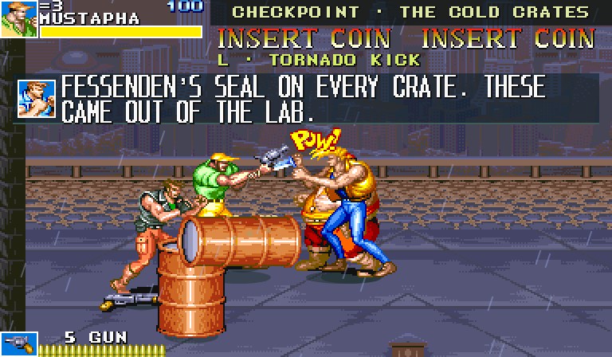

# Cadillacs & Dinosaurs II: Fessenden's Legacy

An unofficial single-player fan sequel to Capcom's 1993 arcade game, made for Mostafa's next adventure. Mustapha, Jack, Hannah and Mess return six months after the first game's exact ending for six chapters, six elites, six bosses and a final clone war.

Fessenden died a beast in the throne room of his Under World beneath the City in the Sea, and the sea poured into the hole his lab left. His chief assistant, Dr. Echo, walked out with his archive and grows numbered copies ("lots") of anyone whose blood the lab ever took. Marshal Sable, the Wassoon lawman who was guarding the captured Black Marketeers, buys them to build an army that never runs out. [Read the sequel script](STORY.md).

| Ch | Chapter | Place | Elite | Boss |
|---|---|---|---|---|
| 1 | WASSOON · *Faces from the Lab* | Hannah's harbour city, a burning jail barge | LOT 07 · Heavy | Warden Rook, a copy of the Butcher |
| 2 | THE CORAL CAUSEWAY · *The Pod Convoy* | a tidal highway and an old toll post; the Cadillac chapter | LOT 31 · Outrider | LOT 44 · Mack, a collared vat triceratops, fought from the car |
| 3 | THE VERDANT BIODOME · *The Nursery* | a glass refinery dome turned hatchery | Pack Alpha · Vat Raptor | the Verdant Regent, a vat Shivat chained to a sonic driver |
| 4 | THE SINK · *Where It Ended* | the one deliberate return: the flooded Under World, six months on | the Brood Mother (a Tyrog) | Foreman Cinder, a copy of Morgan, who melts on his own serum |
| 5 | THE OBSERVATORY · *Dr. Echo* | Echo's lab on the cliffs, copied room for room from the Vault | the Mirror Test | LOT 04 · Slice |
| 6 | THE CROWN SPIRE · *Mirror War* | a gothic spire over the Crown dam | the Mirror Gang, your own clone | Marshal Sable, the Crown Engine, LOT 00 · Fessenden |

The last chapter is a clone war: Hannah breaks Echo's command pylons, the freed copies of the heroes (gold outline) fight Sable's controlled copies (the mirror palette) beside you, and after the Crown Engine the last sealed tank releases LOT 00, a copy of Fessenden's final form that melts in stages in the flooding spillway.



## Play or deploy

Open **index.html** (or **PLAY GAME.bat**). Keep the whole folder, including `assets/stages`, `assets/audio` and `assets/sfx`. Offline play from `file://` needs no installation, server or emulator.

For **Vercel**, import this repository, choose **Other**, leave the build and install commands empty and use the output directory **`.`** (`vercel.json` supplies these). There is no build step on Vercel: the generated files are committed. [DEPLOYMENT.md](DEPLOYMENT.md) also covers GitHub Pages.

## What it is made of

Everything you see is the original arcade's own art, read from the 1993 ROM set and recomposed into new places:

- **Heroes** are the arcade's frame records with their own animation timing, holds and weapon placements; the empty gun is hurled at the enemy, as the user asked.
- **Enemies and bosses** are the original bodies with their ROM animations, attack tables and HP; the sequel's villains are copies with new palettes (Rook is a Butcher body, Cinder a Morgan, the Regent a Shivat) and LOT 00 is Fessenden's six-part final form.
- **Stages** are new layouts built from the arcade's own tiles, palettes and walkable bands (no original level is replayed as it was); the Cadillac, the food and score items, the weapons and the effects are ROM records too.
- **The screen** is the cabinet's: 384 × 224 arcade pixels drawn at 2× on a 768 × 448 canvas, the top HUD and the weapon panel in the ROM font at the cabinet's coordinates, chapter cards, intermission panels, the stage-clear tally and the boss cards in the arcade's presentation.
- **Feel**: the heroes walk at the ROM's own speeds (0x50E4, run 0x5064), the hit sparks and POW! are the arcade's records, and the soundtrack and sound effects are the supplied arcade audio.

**Display.** The cabinet's 4:3 picture is the default. The Sound Room's aspect button switches to square pixels (12:7) and back; the setting is saved.

## Controls

| Action | Keyboard | Gamepad |
|---|---|---|
| Move / steer | WASD or arrows | Left stick / D-pad |
| Attack / pick up a weapon you are standing on | J, Z or Space | X / left face button |
| Grab / knee / throw | Walk into an enemy, then J; back + J throws | — |
| Jump / Cadillac boost | K or X | A / bottom face button |
| Special / ram | L or C; also tap attack + jump together | Y / top face button |
| Interact / pick up / throw | E or V | B / right face button |
| Run | double tap ← / → (the run keeps going until you press the other way), or hold Shift | — |
| Pause | Esc or P | Start |
| Drop a coin (continue) | Enter; on the continue screen also J / Space / HIT | Any face button on the continue screen |

**Phones and tablets:** a thumb stick on the left and PICK/USE, SPECIAL, JUMP and HIT/FIRE buttons on the right. Slide your thumb anywhere in the stick to move (diagonals work); push it to the rim to run. Use a second finger for the buttons while moving; hold PICK/USE at consoles. In portrait the controls sit below the playfield; in landscape the playfield fills the screen height and the controls float over its lower corners. Tap ⛶ for fullscreen; ✕ or the pause menu exits. iPhone Safari has no page fullscreen, so use Share → Add to Home Screen for a full-screen launch. Connect a controller and press a button to activate it.

Hold attack for combos. Jump first, then attack for a flying kick; attack while running for a dash strike. Specials cost eight health **when they hit an enemy** and drop the held weapon. Heavy hits also drop weapons, keeping their ammunition.

Pistols, shotguns and rifles carry six rounds; bazookas carry four. Uzis and M-16A1s fire bursts. Shotguns hit a wider lane, rifles penetrate and rockets cause splash damage. **While holding a firearm, J only fires. When the last round is gone the hero hurls the empty gun at the enemy; E throws it earlier or swaps it.** Knives stab nearby enemies or are thrown at distant ones. Broken rods become sticks. Grenades and dynamite arc before exploding.

At a cold pod, valve, winch or pylon, **hold E / PICK** while standing still. At a radio, tap E until its display matches the marked channel. Attack sonic lures and drive into pod crates. Both the enemies and the active objective must be cleared to open the next area.

Break containers for supplies; walk over food to heal (a meal eaten at full health pays its points instead). In the Cadillac, hold → to build speed, ← to brake or back up, and ↑ / ↓ to change lanes; steer into enemies at speed to fling them. J bashes, K boosts and L rams.

## Difficulty, lives and saving

**Easy, Normal and Arcade Mania** change health, food frequency, crowd limits, attack slots, recovery and melee-weapon durability; Mania adds rear flanking, quicker boss decisions and telegraphed dinosaur rage. Three lives per attempt; when they are gone, a ten-second CONTINUE? count runs where the hero fell, and a coin respawns you in place with three more. Only an expired count sends you back to the start of the section.

Progress saves at the start of every section and at chapter completion in browser local storage; cleared chapters unlock for replay. Each site origin (local file, Vercel, GitHub Pages) has its own save. Audio starts after a click or keypress; the Sound Room has music and effects switches, volume, the aspect setting and every track.

## How it is built

There is no build step to play or deploy. The shipped art and data are generated files, committed to the repository:

| File | What it is | Made by |
|---|---|---|
| `sprite-data-heroes.js`, `-fx.js`, `-enemies.js`, `-bosses.js`, `-ui.js` | slot-indexed sprite sheets (data-URL PNGs) with records, animations, holds and palette maps | `node tools/re/build-game-assets.cjs sprites <family>` / `ui` |
| `stage-data.js`, `assets/stages/ch<N>/<area>/*.png`, `assets/stages/pics/*.png` | stage pages (lazy-loaded per chapter), bands, camera, locks, props, intermission pictures | `node tools/re/build-game-assets.cjs stages all` from `tools/re/levels/ch<N>.json` |
| `combat-config.js` | the offline copy of `combat-config.json` | `node tools/build-config.cjs` (or `build-game-assets.cjs config`) |
| `sprites.js` | the runtime colouriser (palette maps over the indexed sheets) and the `ROM_*` globals | hand-written |
| `hero-rig.js`, `enemy-kinds.js` | hero animation player; enemy kinds and `BOSS_DEFS` on ROM data | hand-written |
| `stage-render.js`, `arcade-ui.js`, `sequel-render.js` | stage drawing; the ROM-font HUD, cards and panels; the readiness facade the tests wait on | hand-written |
| `campaign.js`, `mission-data.js` | story, chapters, sections, waves, objectives, radio lines | hand-written |
| `game.js` | the engine: input, combat, AI, bosses, camera, rendering | hand-written |

Rebuilding needs Node 22 and the arcade ROM set outside the repository (`DINO_ROMS`, default `E:/mostafa/dino`) plus the research extracts in `work/re/extract` (not committed). `node tools/re/build-game-assets.cjs check` rebuilds everything into a scratch folder and fails on any pixel or data difference with the shipped files, on the stage gates, and on the budgets (eager download at most 3.5 MB, any shipped file at most 1.5 MB, stage pages at most 1 MB per chapter). Run it before pushing. [SOURCE-NOTES.md](SOURCE-NOTES.md) lists the ROM tables each file comes from.

## Tests

The tests are optional development tools (Playwright, Node 22); nothing in them is needed to play. Install once with `npm install` inside `tests/` and `npx playwright install chromium`. Then, from the repository root (PowerShell):

```text
node tools/serve.cjs 8766
$env:GAME_URL='http://127.0.0.1:8766'; node tools/re/run-suites.cjs --step G8
$env:GAME_URL='http://127.0.0.1:8766'; node tests/bot.cjs
node tests/assets.cjs
node tools/re/compare-frames.cjs
```

`run-suites.cjs` runs every suite in `tests/*.cjs` (the gameplay suites, `framing`, `enemies`, `campaign`, `ui`, `rom-heroes`, `assets`, `perf`) plus a `file://` launch. A single suite runs as `node tests/<suite>.cjs`; setting `GAME_URL` to the `file:///…/index.html` address runs it from `file://`. `tests/bot.cjs` plays all six chapters on Easy with ordinary inputs and fails if a chapter takes less than 150 or more than 300 simulated seconds. `tests/assets.cjs` is the asset gate (the build check, budgets, every stage page present). `compare-frames.cjs` sets up the scenes of `tests/fixtures/visual-scenes.json` and writes side-by-side sheets against arcade video frames and MAME snapshots. Results and logs go to the ignored `tests/results/`. [VALIDATION.md](VALIDATION.md) has the latest results.

`LAST_EDEN.snapshot` and the explicitly named `LAST_EDEN.test` helpers support testing (the object keeps its earlier name so saves and tests stay compatible).

## Credits

Original game, artwork and music: **Capcom, Cadillacs and Dinosaurs (1993)**. Characters and setting: **Mark Schultz's Xenozoic Tales**. The art in this sequel is read from the supplied ROM set and recomposed; the ROMs themselves are not included and were only read. The soundtrack and sound effects were supplied by the user. The engine, story, stage layouts and encounters were made for this project. This is an unofficial fan game, not a frame-perfect recreation or an official sequel.
